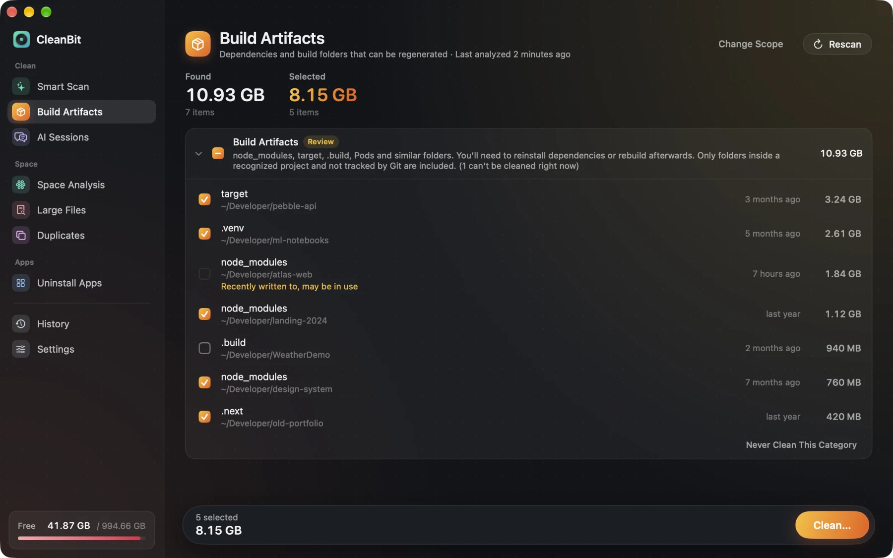
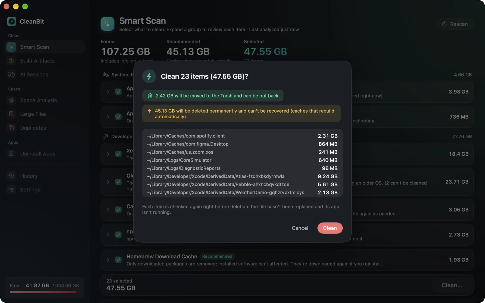

> [!NOTE]
> **Disclosure:** This comparison was written by the developer of **CleanBit**. Every open-source repository, license, release tag, and Mac App Store price below was verified from public GitHub and US Mac App Store listings on **2026-11-26**.

**Which developer disk cleanup tool should you use on a Mac?** There is no single tool that handles everything safely, because Docker virtual disks and Xcode Simulator OS runtimes live outside normal user cache rules. If you want a **Mac App Store sandboxed GUI** that shows per-item impact notes, lists `node_modules` / Rust `target/` / Swift `.build/` with last-modified dates, skips Git-tracked files, moves build folders to the Trash, and offers a one-time lifetime purchase, start with **CleanBit** ([Download on the Mac App Store](https://apps.apple.com/app/apple-store/id6829159531?pt=127116872&ct=website-guides&mt=8) — free scan and first 2 cleans free). If you prefer **open-source CLI tools** in your Terminal, pair **`npkill`** or **`kondo`** for project artifacts with first-party commands (`docker system prune`, `xcrun simctl`, `brew cleanup`, `pnpm store prune`)—or use **Mole** if you want a broad open-source CLI/app outside the Mac App Store. If you only clean Xcode caches, **DevCleaner for Xcode** is free on the Mac App Store.

On one developer Mac we measured (read-only `du` across the home folder, excluding `~/Library`), developer and AI directories dwarfed everyday clutter: **304 `node_modules` folders occupied 66.3 GB**, **8 `.venv` folders occupied 5.1 GB**, **7 `.build` folders occupied 2.9 GB**, **`CoreSimulator/Devices` occupied 43.0 GB**, **`iOS DeviceSupport` occupied 24.1 GB**, **`DerivedData` occupied 15.3 GB**, **`uv` cache occupied 8.0 GB**, **`pnpm` store occupied 6.8 GB**, **`~/.codex` occupied 5.2 GB**, **`~/.claude` occupied 1.9 GB**, and **`~/.cache/huggingface` occupied 17.0 GB**. Remember that `du` reports total directory size, not how much is safe to remove blindly.

> [!TIP]
> **Audit Read-Only First — or Scan Visually for Free:** Want a zero-install, read-only Terminal command (`du` and `find` only, zero deletions) tailored to Xcode, Node, Rust, Docker, and AI coding tools? Try our free [Mac Disk Check audit script generator](/tools/disk-check/). Ready to inspect what is safely cleanable with Trash recovery? **[Download CleanBit on the Mac App Store →](https://apps.apple.com/app/apple-store/id6829159531?pt=127116872&ct=website-guides&mt=8)**

## Quick Recommendations by Developer Workflow

- **Developers on company-managed Macs or anyone wanting a sandboxed GUI with Git-safe Trash recovery:** **CleanBit** (Mac App Store, macOS 15+, free scan + 2 free cleans, $29.99 lifetime option) — Covers Xcode, 12+ package managers, Git-aware build artifacts (`node_modules`, `target`, `.build`, `.venv`, `Pods`), Claude Code/Codex sessions, plus everyday Mac clutter without root privileges.
- **Terminal-first JS/TS & polyglot developers cleaning project build directories:** **`npkill`** (v1.0.0, MIT) for fast interactive TUI pruning, or **`kondo`** (v0.9, MIT) for Rust-speed multi-language cleanup with `--older` age filters.
- **Docker images, build caches, Xcode Simulator OS runtimes & `pnpm` stores:** **Built-in first-party CLIs** (`docker system prune`, `xcrun simctl`, `brew cleanup`, `pnpm store prune`) — Always the safest and most accurate way to reclaim daemon-managed or hard-linked storage.
- **Developers who want an all-in-one open-source CLI + native app outside the App Store:** **Mole** (`tw93/Mole`, v1.74.0, GPLv3) — Fast Terminal workflow plus native app interface for broad cache and project cleanup.
- **iOS/macOS developers who only need Xcode cleanup:** **DevCleaner for Xcode** (v2.8.0, GPLv3, free on Mac App Store) — Focused solely on `~/Library/Developer`.
- **Visualizing massive mystery folders (Docker disk images, datasets, raw builds):** **DaisyDisk** (v4.34.3, $9.99 one-time on Mac App Store) — Fastest visual sunburst map when you want to inspect and delete manually.

## Side-by-Side Comparison: CLI & GUI Developer Disk Cleaners (Verified 2026-11-26)

| Tool (Type) | Pricing & License (Verified 2026-11-26) | Distribution & Privileges | Deletion Safety & Trash Recovery | Xcode, Artifacts, Docker & AI Coverage |
|---|---|---|---|---|
| **CleanBit** (GUI · v1.0.1) | Free scan + 2 free cleans; **$4.99/mo**, **$19.99/yr**, or **$29.99 lifetime** | **Mac App Store only** (App Sandbox, no root, optional FDA) | Three tiers (*Recommended*, *Review*, *Info Only*); skips Git-tracked dirs & running apps; Review, artifacts & AI sessions always move to **Trash** | Xcode, 12+ pkg managers, Git-safe `node_modules`/`target`/`.build`/`.venv`/`Pods`, Claude Code/Codex sessions; Docker image & local AI models **Info Only** |
| **First-Party CLIs** (`docker`, `simctl`, `brew`, `pnpm`) | **Free** (bundled with each tool) | Native CLI / daemon APIs | Tool-aware pruning (protects running containers, active runtimes, referenced hard links); permanent removal | Best for **Docker** images/volumes, **Simulator OS runtimes**, Homebrew bottles, and **`pnpm` store** |
| **npkill** (CLI · v1.0.0) | **Free** · MIT open source | npm / `npx npkill` (runs with user shell permissions) | Interactive list with size & last-modified date; deletes selected targets directly (`--dry-run` / risk indicators available) | `node_modules` and multi-ecosystem build artifacts/caches (v1.0); no Xcode/Docker/everyday GUI |
| **kondo** (CLI + optional GUI · v0.9) | **Free** · MIT open source | Cargo / Homebrew / GitHub binary (user permissions) | Supports dry-run listing, `--older` age filter, and interactive confirmation; permanent delete by default | Multi-language project artifacts (`node_modules`, Cargo `target`, Swift, Gradle, Maven, Python, Unity); no Xcode/Docker/AI |
| **Mole** (`tw93/Mole` · CLI + App · v1.74.0) | **Free** · GPLv3 open source | Homebrew / GitHub direct download (outside App Sandbox) | Interactive CLI (`mo`) & native app; supports dry-run previews and project purge; deep system tasks may request elevated permissions | Broad macOS caches, developer caches, project artifacts, and uninstall; no Mac App Store sandbox isolation |
| **DevCleaner for Xcode** (GUI · v2.8.0) | **Free** · GPLv3 open source (optional tip jar) | **Mac App Store** (App Sandbox) or GitHub | Clear Xcode breakdown with confirmation before removal | `DerivedData`, `iOS DeviceSupport`, `Archives`, logs (**Xcode only**) |
| **DaisyDisk** (GUI · v4.34.3) | **$9.99 one-time** | **Mac App Store** (App Sandbox) or standalone direct download | Sunburst map + collector bar confirmation; manual decisions (no cache safety rules or Git checks) | Visualizes any granted folder size (including Docker disk images & models); no automated dev/AI rules |

> [!TIP]
> **Want to see how much space Xcode, package caches, `node_modules`, and AI tools occupy on your Mac before deleting anything?** Scanning and space analysis in CleanBit are unlimited and free, and your first 2 cleans are free. **[Get CleanBit on the Mac App Store →](https://apps.apple.com/app/apple-store/id6829159531?pt=127116872&ct=website-guides&mt=8)**

## 1. CleanBit: Disk Space Cleaner (Sandboxed Mac App Store GUI)

**Best for:** Developers and AI coding users who want a Mac App Store app (no root password, no background helper daemon) that combines visual inspection, Git-aware project artifact safety, Trash recovery, and everyday Mac cleanup in one interface.

Instead of lumping disposable caches and project files under a single "Clean" button, CleanBit organizes developer and Mac storage into three explicit risk tiers:

- **Smart Scan — Recommended (rebuilds automatically):** Covers **Xcode `DerivedData`**, **Old `iOS DeviceSupport` Versions** (automatically keeping the 2 most recently modified versions per platform), **SwiftUI Preview Data**, **Caches Inside Simulator Devices** (reading each simulator's `device.plist` so only shut-down simulators are cleaned while test apps and data stay intact), **12+ package manager caches** (`npm`, Yarn/Yarn Berry, Bun, `node-gyp`, `pip`, `uv`, Swift Package Manager, CocoaPods, Homebrew downloads, Go, Cargo, Gradle build cache—without touching dependency module caches), **Old Claude Code Versions** (preserving the active binary symlink and newest version), **Claude Desktop Caches**, browser caches, and user app caches (locking caches of running apps). On our measured developer Mac, the scan engine found 124.29 GB across Smart Scan rules and marked 66.43 GB as safely cleanable (including 16.42 GB `DerivedData`, 12.76 GB old `iOS DeviceSupport` with the 2 newest locked, 9.29 GB shut-down simulator caches with 15 active entries locked, and 8.58 GB `uv` cache).
- **Build Artifacts & AI Sessions — Review (never pre-selected; always moved to Trash):** Scans visible home folders plus `~/.claude/worktrees` and `~/.codex/worktrees` for `node_modules`, Rust `target/`, Swift `.build/`, Python `.venv/`, `Pods`, and more. Each entry displays **when the project was last modified** (sorted by size) and CleanBit parses `.git` directories and worktree `gitdir:` pointers (Git index v2/v3/v4) to **skip any folder containing Git-tracked files**. The separate **AI Sessions** view filters top-level `.jsonl` transcripts in `~/.claude/projects` (skipping `memory/`) and `~/.codex/sessions` by age. Everything in Review moves to the Trash so you can put it back.
- **Info Only (shown for visibility; never deletable):** Displays sizes for **Docker Desktop virtual disk images**, hard-linked **`pnpm` stores** (reminding you to use `pnpm store prune`), and local AI models (**Hugging Face, Ollama, LM Studio, PyTorch**) so you can see where 20–80 GB sits without risking accidental removal.



Before anything is removed, CleanBit shows a confirmation sheet splitting what moves to the **Trash** versus what is **permanently deleted** (Recommended caches can also be switched to move to the Trash in Settings), and re-verifies each path and running-app lock right before deletion. File names, paths, and file contents never leave your Mac (CleanBit uses Firebase Analytics only for anonymous usage counts and MB-rounded totals per built-in rule ID).



**Pricing (Verified 2026-11-26):** Unlimited scanning and Space Analysis for free, plus your **first 2 cleans free**. Unlock unlimited cleaning via **$4.99/month**, **$19.99/year**, or **$29.99 lifetime** on the Mac App Store (9 languages, macOS 15+).

**Who CleanBit is NOT for (honest boundaries):**
- **Developers who want automated Docker pruning or Simulator OS runtime deletion:** Because CleanBit runs inside Apple's App Sandbox with no root access, it lists Docker Desktop disk images as Info Only and cannot remove system-level Simulator runtimes under `/Library/Developer/CoreSimulator`. Pair it with `docker system prune` and `xcrun simctl runtime delete` below.
- **Macs on macOS 14 Sonoma or earlier:** CleanBit requires **macOS 15 or later**.
- **Terminal-only or headless CI/SSH workflows:** If you never want a GUI or want cleanup inside shell scripts, use `npkill`, `kondo`, or native CLIs.
- **Cursor-specific cache automation, `/private/tmp`, or APFS local snapshots:** CleanBit does not currently have a dedicated Cursor cleaner rule, and sandboxed apps cannot access `/private/tmp` or APFS snapshots.

## 2. First-Party Developer CLIs (`docker`, `xcrun simctl`, `brew`, `pnpm`)

**Best for:** Reclaiming Docker images and build cache, multi-gigabyte Xcode Simulator OS runtimes, Homebrew downloads, and `pnpm` hard-linked stores—areas where third-party GUI cleaners either lack daemon visibility or risk breaking hard links.

Start with **read-only inspection** before deleting anything:

```bash
# 1. Inspect Docker images, containers, volumes, and build cache (read-only)
docker system df

# 2. List installed Xcode Simulator OS runtimes (often 7-10 GB each)
xcrun simctl runtime list

# 3. Preview what Homebrew would remove without deleting anything
brew cleanup --prune=all -n
```

When you are ready to reclaim space safely:

```bash
# Docker: remove stopped containers, unused networks, dangling images & build cache
# (add -a only if you want to remove unused tagged images; avoid --volumes unless intentional)
docker system prune
docker builder prune

# Xcode: remove unavailable simulators & runtimes unused for 30+ days
xcrun simctl delete unavailable
xcrun simctl runtime delete --notUsedSinceDays 30

# Package managers: Homebrew old bottles & unreferenced pnpm store packages
brew cleanup --prune=all
pnpm store prune
```

- **Strengths:** Always accurate for daemon-managed storage (`docker`, `CoreSimulatorService`) and hard-linked stores (`pnpm`). Zero extra software to install, works identically on any macOS version, and leaves no third-party permissions behind.
- **Trade-offs & Limitations:** You have to remember half a dozen different commands across ecosystems, there is no unified view of what is taking the most space across your Mac, and most CLI commands delete permanently rather than moving files to the Trash. For deeper walkthroughs, see our guides on [Xcode `DerivedData`](/guides/is-xcode-deriveddata-safe-to-delete/), [`iOS DeviceSupport` and Simulators](/guides/ios-devicesupport-and-simulators-disk-space-mac/), and [leftover Claude Code git worktrees](/guides/claude-code-worktrees-disk-space-mac/).

## 3. npkill (Open-Source CLI — v1.0.0, MIT)

**Best for:** JavaScript/TypeScript and full-stack developers who want the fastest interactive Terminal workflow to hunt down old `node_modules` and project artifacts without installing a desktop app.

```bash
# Inspect and clean interactively inside a specific workspace directory
cd ~/Repos
npx npkill
```

- **Strengths:** `voidcosmos/npkill` (9,600+ GitHub stars, MIT license, v1.0.0 released November 2026) runs straight from `npx` with zero setup, displays directory sizes and last-modified timestamps in a responsive keyboard-driven TUI, and expanded in v1.0 beyond `node_modules` to additional project artifact targets and caches.
- **Trade-offs & Limitations:** Terminal-only and focused on project directories rather than Xcode (`DerivedData`, `DeviceSupport`, Simulators), browser/app caches, or AI coding transcripts. Deletions are direct rather than using macOS Trash recovery by default, so always double-check active dev servers and `git status` before pressing Space. See our full [Mac `node_modules` cleanup guide](/guides/how-to-find-and-delete-old-node-modules-on-mac/) for `find` and `pnpm` caveats.

## 4. kondo (Open-Source CLI & Optional GUI — v0.9, MIT)

**Best for:** Polyglot developers juggling Rust (`target/`), Node (`node_modules`), Swift, Python, Java/Gradle, Go, or Unity repositories who want fast, scriptable age-based pruning.

```bash
# Preview cleanable project artifacts older than 60 days (read-only)
kondo --older 60d ~/Repos
```

- **Strengths:** Written in Rust (`tbillington/kondo`, 2,600+ GitHub stars, MIT license, v0.9), `kondo` scans huge repository trees in seconds, recognizes dozens of language ecosystems automatically, and makes it easy to filter by project age (`--older`) or preview results before deleting.
- **Trade-offs & Limitations:** Like `npkill`, `kondo` targets project build artifacts only—it does not manage Xcode caches in `~/Library/Developer`, Homebrew/uv/pip caches, Docker, Claude Code/Codex session logs, or everyday macOS caches. Deletions are permanent by default rather than moving folders to the Trash.

## 5. Mole (`tw93/Mole` — Open-Source CLI + Native App, v1.74.0, GPLv3)

**Best for:** Developers on personal Macs who want a fast, actively maintained, free open-source all-in-one cleaner with both a Terminal CLI (`mo`) and a native app interface, and who are comfortable installing software outside the Mac App Store.

- **Strengths:** `tw93/Mole` (76,000+ GitHub stars, GPLv3, v1.74.0 released November 2026) combines system/app cache cleanup, developer cache & project artifact purging, disk analysis, and app uninstallation into one lightweight open-source toolkit installable via Homebrew or GitHub. It supports dry-run previews and quick keyboard navigation for developers who live in the shell.
- **Trade-offs & Limitations:** Distributed outside the Mac App Store (not sandboxed under Apple's App Sandbox), and deep system cleanup routines may prompt for elevated permissions. That makes it a stronger fit for personal developer machines than for locked-down corporate Macs that restrict unsigned/non-App-Store utilities or disallow elevated cleanup tools.

## 6. DevCleaner for Xcode (Free Open-Source Mac App Store GUI — v2.8.0, GPLv3)

**Best for:** iOS, macOS, and Swift developers whose storage crunch is almost entirely inside `~/Library/Developer` and who want a free, inspectable Mac App Store utility.

- **Strengths:** Completely free and open source (`vashpan/xcode-dev-cleaner`, 1,600+ GitHub stars, GPLv3, v2.8.0, macOS 14+). It breaks down `DerivedData`, `iOS DeviceSupport`, `Archives`, and Xcode logs cleanly inside Apple's App Sandbox with zero upsells.
- **Trade-offs & Limitations:** Focused exclusively on Xcode. It will not detect `node_modules`, Rust `target/`, Python `.venv/`, package manager caches (`npm`, `uv`, `Cargo`, `Homebrew`), Claude Code/Codex sessions, or everyday Mac clutter.

## 7. DaisyDisk (Mac App Store Visual Disk Analyzer — v4.34.3, $9.99 One-Time)

**Best for:** Developers who want an ultra-fast visual map to spot huge single files—like a 60 GB `Docker.raw` disk image, forgotten LLM weights, or raw screen recordings—and decide manually what to delete.

- **Strengths:** At **$9.99 one-time** on the Mac App Store (v4.34.3, macOS 12+), DaisyDisk's interactive sunburst chart makes it effortless to drill from `/` down to the exact folder eating 50 GB.
- **Trade-offs & Limitations:** DaisyDisk is a visualizer, not a rule-based developer cleaner. It will show you a 20 GB folder inside `~/Library` or a workspace, but it will not explain whether deleting that folder breaks an active simulator, lock running apps' caches, or check whether files are tracked by Git. (See our broader [Mac App Store disk cleaner comparison](/guides/best-disk-cleaners-mac-app-store/) for how DaisyDisk compares with CleanMyMac, Cleaner One Pro, and CleanBit.)

## A Practical Hybrid Cleanup Routine for Mac Developers

Most Mac developers get the best results—and fewest broken builds—by combining **one visual/sandboxed audit** with **two first-party CLI checks** once a month:

1. **Check the big-picture footprint first (read-only):** Run the [Mac Disk Check audit script](/tools/disk-check/) or a free CleanBit Smart Scan to see whether your space went to Xcode, `node_modules` / worktrees, package caches, Docker, or local AI models.
2. **Reclaim daemon-managed & hard-linked storage with first-party CLIs:** Run `docker system df` → `docker system prune`, `xcrun simctl delete unavailable`, and `pnpm store prune` so Docker, CoreSimulator, and `pnpm` maintain their own internal indexes.
3. **Clean build artifacts and AI sessions with Trash recovery:** Remove old `node_modules`, `target/`, `.build/`, and stale Claude Code / Codex transcripts (see our [Claude Code, Cursor, and Codex storage guide](/guides/claude-code-cursor-codex-disk-space-mac/)) through CleanBit's Review tier (moved to Trash, skipping Git-tracked files) or carefully via `npkill` / `kondo` after checking `git status`.
4. **Leave system-managed storage to macOS:** Never run blind `sudo rm -rf` on `/System/Library/Caches`, `/Library/Caches`, or APFS local snapshots—and check our guide on [whether `~/Library/Caches` is safe to delete](/guides/is-it-safe-to-delete-library-caches-mac/) before clearing user caches manually.

## Frequently Asked Questions

### What is the safest way to clean developer disk space on a Mac without breaking projects?
Start with a read-only audit (`du` / `docker system df` / `xcrun simctl runtime list`, or a free visual scan) before deleting anything. Quit Xcode and stop active dev servers first, use first-party commands for Docker and Simulator runtimes, never delete directories containing Git-tracked files, and move project build artifacts (`node_modules`, `target/`, `.build/`) to the Trash rather than running blind `rm -rf`.

### Should I use a CLI tool like `npkill` / `kondo` or a GUI cleaner like CleanBit?
Use CLI tools (`npkill`, `kondo`, `docker system prune`, `xcrun simctl`) if you prefer Terminal workflows, want scriptable age filters, or need to prune Docker images and Simulator OS runtimes. Use a sandboxed Mac App Store GUI like **CleanBit** if you want one place to inspect Xcode caches, 12+ package managers, Git-safe build artifacts, AI coding sessions, and everyday Mac clutter with plain-language impact notes and Trash recovery—especially on a company-managed Mac.

### Can any Mac App Store disk cleaner shrink Docker Desktop's `Docker.raw` file?
No sandboxed Mac App Store app should delete `Docker.raw` directly, because removing that virtual disk image wipes all of your Docker images, containers, and volumes at once. CleanBit lists Docker Desktop's disk image as **Info Only** so you can see its size, and you should reclaim space inside Docker using `docker system prune` and `docker builder prune` (or Docker Desktop's Disk Usage UI).

### How do I clean `node_modules` and `target/` inside Claude Code or Codex git worktrees?
Each parallel `git worktree` creates its own untracked `node_modules`, Rust `target/`, or Swift `.build/` directory. Check `git worktree list` and use `git worktree remove <path>` after merging, or delete only the disposable build folder inside paused worktrees. CleanBit's Build Artifacts module automatically scans `~/.claude/worktrees` and `~/.codex/worktrees`, parses `.git` `gitdir:` pointers to skip Git-tracked files, and moves selected build folders to the Trash.

### Is it safe to delete `~/Library/Developer/Xcode/DerivedData` and old `iOS DeviceSupport`?
Yes—Xcode regenerates `DerivedData` on the next build and re-copies `DeviceSupport` symbols if you reconnect an older physical iOS device. Quit Xcode first, keep the 1–2 newest `iOS DeviceSupport` versions for devices you actively debug, and review `Xcode/Archives` carefully so you do not delete `.xcarchive` dSYM bundles needed for crash symbolication.

### What is free to use in CleanBit before paying?
Scanning, Space Analysis, Large Files, Duplicate Files inspection, and your **first 2 cleans are free** on the Mac App Store—no account signup required. Unlimited cleaning is available via $4.99/month, $19.99/year, or a $29.99 one-time lifetime purchase (US Mac App Store pricing verified 2026-11-26).
