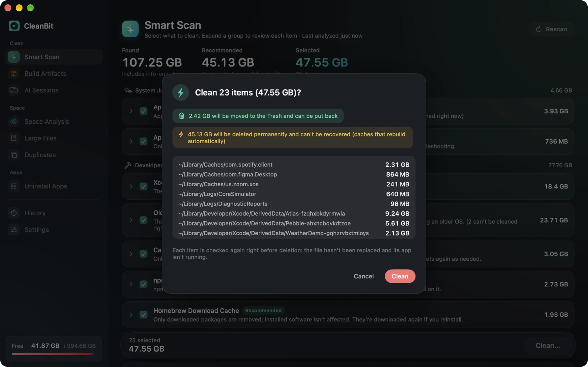

> [!NOTE]
> **Disclosure:** This comparison was written by the developer of **CleanBit**. Every app listed below is distributed through Apple's Mac App Store (no unverified external installers), and all prices, versions, and feature notes were verified from public US Mac App Store listings on **2026-11-25**. Regional App Store pricing may vary.

**Which Mac App Store disk cleaner should you pick?** If you want a sandboxed cleaner that explains what every item is before deleting it, sends review items to the Trash, handles both everyday clutter and developer/AI tool caches, and offers a one-time lifetime purchase, start with **CleanBit** ([Download on the Mac App Store](https://apps.apple.com/app/apple-store/id6829159531?pt=127116872&ct=website-guides&mt=8) — free scan and first 2 cleans free). If you only want a visual folder map to hunt down big files manually for $9.99 once, pick **DaisyDisk**. If you want a broad all-in-one suite billed through your Apple Account, look at **CleanMyMac** or **Cleaner One Pro**—and if you only clean Xcode caches, **DevCleaner for Xcode** is free and open source.

Every app on this list runs inside Apple's **App Sandbox**—meaning no root password prompts and no persistent privileged helper daemons installed outside the App Store. That makes them a practical fit for everyday Mac users who want lower risk, and for developers on company-managed Macs where unsigned external `.dmg` tools are restricted.

> [!TIP]
> **Quick Try (Free Scan + 2 Free Cleans):** Want to see what is filling your home folder—old `.dmg` installers, browser caches, app leftovers, Xcode caches, or `node_modules`—with plain-language impact notes before you pay anything? **[Download CleanBit on the Mac App Store →](https://apps.apple.com/app/apple-store/id6829159531?pt=127116872&ct=website-guides&mt=8)** (or try our zero-install, read-only [Mac Disk Check audit script generator](/tools/disk-check/) first).

## Quick Recommendations by Use Case

- **Everyday Mac users & developers who want clear explanations + one-time purchase option:** **CleanBit** — Three risk tiers (*Recommended*, *Review*, *Info Only*), Trash recovery for review items, everyday cleanup (installers, browser/app caches, large files, duplicates, uninstaller) plus developer & AI coding tool support.
- **Visual storage explorers who prefer manual drag-and-drop:** **DaisyDisk** ($9.99 one-time) or **Disk Space Analyzer Pro** ($13.99 one-time) — Fast sunburst maps showing where gigabytes live, without automated cache rules.
- **Users who want a mainstream all-in-one suite on Apple ID billing:** **CleanMyMac (Mac App Store edition)** or **Cleaner One Pro** — Broad everyday feature sets with recurring subscription options (CleanMyMac also lists a one-time option for the current major version).
- **Minimal budget checklist on older macOS (10.13+):** **Disk Doctor: System Cleaner** ($2.99 one-time) — Simple category checkboxes for basic caches, logs, and downloads.
- **iOS/macOS developers who only clean Xcode:** **DevCleaner for Xcode** (Free, open source) — Purpose-built for `~/Library/Developer` caches and nothing else.

## Side-by-Side Comparison (Mac App Store Editions — Verified 2026-11-25)

All information below reflects the **Mac App Store** editions verified on **2026-11-25** (some vendors also sell separate direct-download versions outside the App Store with different permissions and pricing).

| App (Mac App Store) | Pricing Model (Verified 2026-11-25) | Sandboxed / No Root Helper | Pre-Delete Impact & Trash Recovery | Dev & AI Coding Caches | Languages & Min macOS |
|---|---|---|---|---|---|
| **CleanBit** (v1.0.1) | Free scan + 2 free cleans; **$4.99/mo**, **$19.99/yr**, or **$29.99 lifetime** | Yes (MAS-only; optional FDA) | Per-item impact notes; Review, artifacts, AI sessions & uninstalled apps always move to Trash (Recommended caches Trash-optional) | Xcode, 12+ pkg managers, Git-safe `node_modules`/`target`/`.build`/`.venv`, Claude Code & Codex sessions; local models Info Only | 9 languages · macOS 15+ |
| **CleanMyMac** (v5.7.4) | Free download + trial; subscription IAPs & current-major-version one-time option (see MAS listing) | Yes (MAS edition is sandboxed; direct download uses helper) | Guided category cleanup; confirmation dialogs; permanent deletion for most junk categories | Basic Xcode/dev junk; no dedicated AI coding agent session or Git-aware artifact rules | 12 languages · macOS 11+ |
| **DaisyDisk** (v4.34.3) | **$9.99 one-time** (no subscription) | Yes (MAS edition omits admin scan & cloud scan) | Visual sunburst map; collector bar requires explicit confirmation before deleting | Shows folders by size only; no built-in cache/dev safety classification | 13+ languages · macOS 12+ |
| **Cleaner One Pro** (v6.6.9) | Free download; subscription IAPs (typically from ~$19.99/yr in US MAS) | Yes (MAS sandboxed) | Category junk scanner, duplicate photos & app manager | General logs/caches; no dedicated AI tool or Git-aware build artifact rules | 17+ languages · macOS 10.15+ |
| **Disk Space Analyzer Pro** (v6.0.3) | **$13.99 one-time** (free Inspector version also listed) | Yes (MAS sandboxed) | Visual sunburst chart & large file list; manual removal to Trash or permanent delete | Shows folders by size only; no built-in dev/AI cache rules | 8 languages · macOS 11+ |
| **Disk Doctor** (v4.6) | **$2.99 one-time** (Pro edition $5.99) | Yes (MAS sandboxed) | Simple category checklist (caches, logs, downloads, mail downloads, large files) | Basic "Developer Files" category only; no AI coding tools | English only · macOS 10.13+ |
| **DevCleaner for Xcode** (v2.8.0) | **Free** (open source; optional tip jar) | Yes (MAS sandboxed) | Lists `DerivedData`, `DeviceSupport`, archives with confirmation | Xcode (`~/Library/Developer`) only | English only · macOS 14+ |

> [!TIP]
> **Ready to test CleanBit on your own Mac?** Scanning and space analysis are unlimited and free, and your first 2 cleans are free—no account signup required. **[Get CleanBit on the Mac App Store →](https://apps.apple.com/app/apple-store/id6829159531?pt=127116872&ct=website-guides&mt=8)**

## 1. CleanBit: Disk Space Cleaner

**Best for:** Everyday Mac users who want to understand every file before removing it, company-managed Macs that require Mac App Store software, and developers or AI coding users who want one tool that covers both routine clutter and multi-gigabyte build/AI caches.

CleanBit is built natively in SwiftUI for macOS 15+ and distributed exclusively on the Mac App Store inside Apple's App Sandbox. Instead of presenting one giant gigabyte total and a blind "Clean" button, CleanBit organizes findings into three explicit safety tiers:

- **Recommended (rebuilds automatically):** User app caches (automatically locking caches of currently running apps and skipping Apple subsystem caches), browser caches (Safari, Chrome, Edge, Brave, Arc, Vivaldi, Firefox—without touching cookies, history, or passwords), Xcode `DerivedData`, old `iOS DeviceSupport` versions, SwiftUI previews, shut-down simulator caches, 12+ package manager caches (`npm`, Yarn, Bun, `pip`, `uv`, SwiftPM, CocoaPods, Homebrew, Go, Cargo, Gradle), and old Claude Code binaries. Deleted permanently by default so space returns immediately, or you can switch Recommended items to move to the Trash in Settings.
- **Review (never pre-selected; always moved to Trash):** Old installers (`.dmg`, `.pkg`, `.iso`, `.xip`) in Downloads, uninstalled app leftovers, project build artifacts (`node_modules`, Rust `target/`, Swift `.build/`, Python `.venv/`, `Pods`—showing each project's last-modified date and skipping Git-tracked files, including `~/.claude/worktrees` and `~/.codex/worktrees`), old Claude Code and Codex `.jsonl` sessions filtered by date, and uninstalled apps. Everything in this tier moves to the Trash so you can put it back.
- **Info Only (shown for awareness; never deletable):** Local AI models (Hugging Face, Ollama, LM Studio, PyTorch), hard-linked `pnpm` store, and Docker Desktop virtual disk images—so you can see where 20–80 GB went without risking accidental removal.

Beyond Smart Scan (which supports per-group cleaning in v1.0.1), CleanBit includes a drill-down **Space Analysis** map, a **Large Files** finder (filterable by size and last-opened date), a byte-identical **Duplicate Files** finder (always keeping at least one copy), an **App Uninstaller**, an optional menu bar utility with low-space alerts, and a **Dry Run Mode**.

Before anything is removed, CleanBit displays a confirmation sheet that explicitly separates how much goes to the **Trash** versus what is **permanently deleted**, and re-verifies each path, file identity, and running-app lock immediately before deletion. File names, paths, and file contents never leave your Mac (CleanBit uses Firebase Analytics only for anonymous usage counts and MB-rounded totals per built-in rule ID).

**Pricing (Verified 2026-11-25):** Unlimited scanning and space analysis for free, plus your **first 2 cleans free**. Unlock unlimited cleaning via **$4.99/month**, **$19.99/year**, or a **$29.99 one-time lifetime purchase** through the Mac App Store (9 languages supported: English, Simplified & Traditional Chinese, Japanese, Korean, French, German, Spanish, Russian).

**Who CleanBit is NOT for (honest boundaries):**
- **Macs running macOS 14 Sonoma or earlier:** CleanBit requires **macOS 15 (Sequoia) or later**. If you are on an older macOS release, look at DaisyDisk (macOS 12+), Disk Space Analyzer Pro (macOS 11+), or Disk Doctor (macOS 10.13+).
- **Users trying to purge APFS local snapshots or system-level `/Library/Caches`:** CleanBit intentionally stays inside Apple's App Sandbox without root access, so it cannot touch APFS Time Machine local snapshots, `/System/Library/Caches`, `/private/tmp`, or iCloud Drive synced files.
- **Users looking for security/threat scanning or cloud-drive cleanup:** CleanBit is strictly a local disk space cleaner—it does not include security scanning, "RAM freeing", or "Mac speed-up" modules.
- **Cursor-specific cache automation:** CleanBit does not currently include a dedicated Cursor cleaner rule (see our manual [Claude Code, Cursor, and Codex storage guide](/guides/claude-code-cursor-codex-disk-space-mac/) for safe Cursor steps).

## 2. CleanMyMac by MacPaw (Mac App Store Edition)

**Best for:** Everyday Mac users who want a long-standing, polished all-in-one maintenance app billed through their Apple Account rather than a separate vendor account.

- **Strengths:** CleanMyMac (v5.7.4 on the Mac App Store, macOS 11+, 12 languages) offers a well-known interface combining cache/log cleanup, large-file visualization, photo clutter tools, and security checks. Downloading from the Mac App Store keeps billing inside Apple ID settings and avoids external `.dmg` installers.
- **Trade-offs & Limitations:** CleanMyMac is in a higher price bracket than focused disk utilities, with subscription plans and a one-time option that historically covers only the current major version (verify exact current tiers in the Mac App Store listing). Because Apple enforces sandboxing on Mac App Store apps, the App Store edition also omits certain deep system-level privileges available only in MacPaw's direct-download version. For developers, it is not specialized in AI coding agent sessions or Git-aware `node_modules` / worktree cleanup.

## 3. DaisyDisk (Mac App Store Edition)

**Best for:** Users who already know their way around their files and want the fastest, cleanest visual map of disk usage for a low one-time price.

- **Strengths:** At **$9.99 one-time** (v4.34.3, macOS 12+, 13+ languages), DaisyDisk is one of the best-designed Mac utilities ever made. Its interactive sunburst chart makes it effortless to spot forgotten 40 GB video folders, raw media exports, or bloated backup archives, drop them into the collector bar, and delete them after review.
- **Trade-offs & Limitations:** DaisyDisk is a **disk visualizer**, not a rule-based cleaner. It shows you *how big* a folder inside `~/Library` is, but it does not explain whether deleting a specific cache folder is safe, lock running apps' caches, or distinguish Git-tracked files inside project folders. Note also that the Mac App Store edition is sandboxed and does not include the "Scan as Administrator" or cloud-storage scanning modes from DaisyDisk's standalone website version (Software Ambience offers a free migration path to standalone if you later decide you need admin scans).

## 4. Cleaner One Pro (Trend Micro)

**Best for:** Mainstream Mac users—especially on older macOS versions—who want an all-in-one utility from a recognizable security company covering junk cleanup, similar photo detection, and app management.

- **Strengths:** Cleaner One Pro (v6.6.9, macOS 10.15+, 17+ languages) supports a wide range of languages and older macOS releases. It bundles general junk scanning, duplicate/similar photo cleanup, an app manager, and a menu bar status view in a single Mac App Store download.
- **Trade-offs & Limitations:** Core capabilities such as duplicate cleanup and full app management sit behind recurring subscription In-App Purchases (typically starting around $19.99/year in the US App Store, with no lifetime one-time purchase tier). Like most general suites, it emphasizes quick one-click summaries over item-by-item impact explanations, and it does not target developer build artifacts or AI coding tool directories.

## 5. Disk Space Analyzer Pro (Nektony)

**Best for:** Users who want a visual sunburst disk map plus a straightforward list of the largest files and folders on a Mac, with a one-time Mac App Store purchase.

- **Strengths:** Priced at **$13.99 one-time** (v6.0.3, macOS 11+, 8 languages; a free *Inspector* companion is also available), Nektony's Disk Space Analyzer Pro scans quickly and gives you a clear sunburst view alongside a ranked list of your biggest folders and files so you can clean them up manually.
- **Trade-offs & Limitations:** Like DaisyDisk, it is primarily a visual storage inspector rather than a guided cache or developer cleaner. You are responsible for deciding whether a subfolder inside `~/Library` or a project workspace is safe to remove.

## 6. Disk Doctor: System Cleaner (FIPLAB)

**Best for:** Budget-conscious everyday users on older Macs (macOS 10.13+) who want a minimal, low-cost checklist for routine folders.

- **Strengths:** At **$2.99 one-time** (v4.6, macOS 10.13+; FIPLAB also offers a Pro version at $5.99), Disk Doctor is inexpensive and uncomplicated. It scans standard locations such as Application Caches, Application Logs, Browser Data, Mail Downloads, Downloads, Large Files (>100 MB), and basic Developer Files.
- **Trade-offs & Limitations:** English-only interface, minimal customization, and no visual space map, duplicate file finder, app uninstaller, Git-aware project artifact scanner, or AI tool cleanup rules.

## 7. DevCleaner for Xcode

**Best for:** iOS, macOS, and Swift developers whose main storage problem is Xcode (`~/Library/Developer`) and who want a free, inspectable Mac App Store utility.

- **Strengths:** **Completely free** and open source (v2.8.0, macOS 14+, optional tip jar on the Mac App Store). DevCleaner focuses exclusively on Xcode caches—`DerivedData`, old `iOS DeviceSupport` symbols, archives, and logs—without bloat or upsells.
- **Trade-offs & Limitations:** It cleans **only** Xcode folders. It will not find old `.dmg` installers in Downloads, browser caches, app leftovers, duplicate files, `node_modules` / Rust `target/` folders, or Claude Code / Codex caches.

## What Sandboxed Mac App Store Cleaners Can (and Cannot) Clean

Because Apple requires every Mac App Store app to run in the **App Sandbox**, all seven tools above share an important architectural boundary—and knowing it upfront prevents disappointment:

- **What they CAN safely inspect and clean:** Files inside your user home folder (`~`) that you grant access to—including `~/Downloads` (old `.dmg`/`.pkg` installers), `~/Library/Caches` and browser caches (see our guide on [whether `~/Library/Caches` is safe to delete](/guides/is-it-safe-to-delete-library-caches-mac/)), `~/Library/Logs`, Xcode (`~/Library/Developer`, covered in our [Xcode DerivedData guide](/guides/is-xcode-deriveddata-safe-to-delete/)), package manager caches, project build folders like [`node_modules`](/guides/how-to-find-and-delete-old-node-modules-on-mac/) and [Claude Code git worktrees](/guides/claude-code-worktrees-disk-space-mac/), large personal files, duplicates, and app leftovers.
- **What they CANNOT touch (and why):** Protected macOS system directories (`/System/Library/Caches`, `/Library/Caches`), `/private/tmp`, and **APFS local snapshots** (often the real culprit behind an oversized "System Data" bar in System Settings). Those areas require root privileges or macOS's own `tmutil` management, and macOS normally purges APFS snapshots automatically when storage runs low.

Want to inspect where your storage actually went before installing *any* app? Use our free, zero-install [Mac Disk Check audit script generator](/tools/disk-check/) to copy a read-only Terminal command (`du` and `find` only—zero deletions).

## Frequently Asked Questions

### Are sandboxed Mac App Store disk cleaners safer than direct-download cleaners?
Running inside Apple's App Sandbox reduces the blast radius of a disk cleaner: the app cannot silently request root privileges, install a persistent background helper daemon, or read folders you have not explicitly granted in a macOS open panel. However, you should still review what any tool marks for deletion—even a sandboxed app can delete files inside folders you authorize if you confirm blindly.

### Which Mac App Store disk cleaners offer a one-time purchase instead of a subscription?
As verified on 2026-11-25 in the US Mac App Store, **CleanBit** offers a **$29.99 lifetime one-time purchase** (alongside monthly/yearly plans and 2 free cleans), **DaisyDisk** is **$9.99 one-time**, **Disk Space Analyzer Pro** is **$13.99 one-time**, **Disk Doctor** is **$2.99 one-time**, **DevCleaner for Xcode** is **free**, and **CleanMyMac** lists a one-time option for the current major version in addition to subscriptions.

### How does CleanBit compare to CleanMyMac and DaisyDisk?
**DaisyDisk** ($9.99) is a visual folder-size map—it shows where large files live, while you decide what is safe to delete. **CleanMyMac** is a broader all-in-one suite with subscription tiers, though its Mac App Store edition has fewer system privileges than its direct download. **CleanBit** sits in the middle with transparent safety tiers: it explains what each item is before deletion, sends review items and build artifacts to the Trash, covers both everyday Mac clutter and developer/AI coding caches (`Xcode`, 12+ package managers, Git-aware `node_modules`, Claude Code/Codex), and offers a $29.99 lifetime purchase.

### Do Mac App Store disk cleaners need Full Disk Access?
Not always. For example, CleanBit only asks you to grant your personal home folder (or specific folders) through the standard macOS open panel on first launch. Full Disk Access is strictly optional and is only needed if you want to inspect and clean the Trash, Safari caches, or other sandboxed apps' containers.

### Can a Mac App Store disk cleaner shrink macOS "System Data" or APFS local snapshots?
Partially—only the portion of "System Data" that actually consists of user-space caches, app leftovers, Xcode/developer caches, and AI tool directories inside your home folder (`~`). Sandboxed Mac App Store apps cannot delete APFS local Time Machine snapshots, macOS system updates, or `/System/Library/Caches`; those are managed by macOS itself.

### Is there a free Mac App Store disk cleaner worth trying first?
If you only need to clean Xcode caches, **DevCleaner for Xcode** is completely free and open source. If you want to scan your entire Mac (both everyday caches/installers and developer/AI files) before paying anything, **CleanBit** includes unlimited free scanning, space analysis, and your first 2 cleans for free on the Mac App Store.
