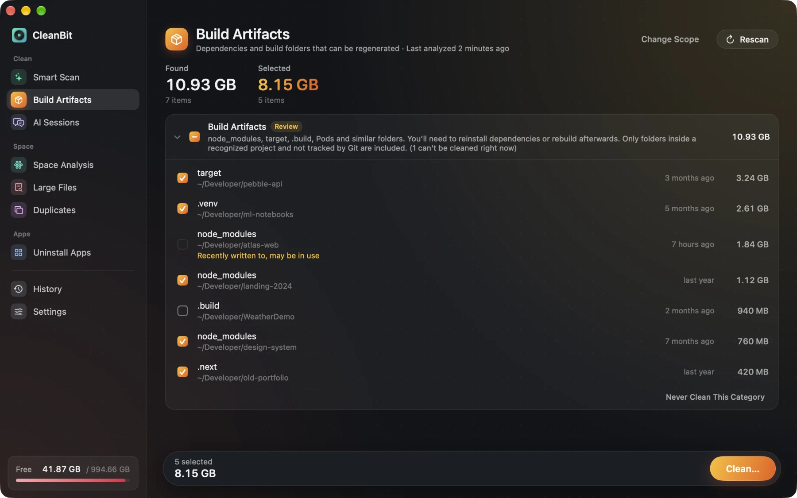

**Claude Code and Codex worktrees fill up your Mac because Git shares commit history across worktrees, but never shares untracked build directories like `node_modules`, Rust `target/`, Swift `.build/`, or Python `.venv/`.** Every parallel agent task that runs `npm install`, `cargo build`, or `swift build` inside its own `git worktree` creates a fresh multi-gigabyte copy of dependencies—and those folders stay on disk even after your PR is merged unless you remove the worktree with `git worktree remove` or clear its build directories.

On one developer Mac we measured (read-only `du` across the home folder, excluding `~/Library`), project build artifacts alone reached **66.3 GB across 304 `node_modules` folders**, **5.1 GB across 8 `.venv` folders**, and **2.9 GB across 7 `.build` folders**—alongside **`~/.claude` (1.9 GB)**, **`~/.local/share/claude` (902 MB)**, and **`~/.codex` (5.2 GB)**. Heavy parallel-agent users hit much steeper spikes: developers on `r/ClaudeCode` and `r/ClaudeAI` have reported leftover agent worktrees growing a single workspace to **95 GB**, and parallel Rust agent checkouts generating **10–40 GB `target/` folders** each until the startup disk hit 95%+ full.

## 1. Run a read-only audit of your worktrees first

Before deleting anything, measure where agent worktrees and their build folders actually sit on your Mac. The commands below are strictly read-only.

### Check worktree storage across common coding-agent locations

```bash
# Total disk usage in common agent worktree directories (read-only)
du -sh \
  ~/.claude/worktrees \
  ~/.codex/worktrees \
  ~/.cursor/worktrees 2>/dev/null

# Largest individual worktree folders inside ~/.claude/worktrees and ~/.codex/worktrees
du -sh ~/.claude/worktrees/* ~/.codex/worktrees/* 2>/dev/null | sort -h | tail -20
```

### List every Git worktree registered by a repository

Claude Code and other tools can also create worktrees inside a hidden folder inside the repo itself (such as `<repo>/.claude/worktrees`) or in a sibling folder next to your repo. Inside any repository, run:

```bash
cd ~/Repos/your-project
git worktree list
```

To see whether any worktrees are locked, detached, or already missing from disk (`prunable`), add `--porcelain`:

```bash
git worktree list --porcelain
```

### Find the biggest `node_modules`, `target`, and `.build` folders inside worktrees

```bash
find ~/.claude/worktrees ~/.codex/worktrees ~/.cursor/worktrees \
  \( -name node_modules -o -name target -o -name .build -o -name .venv \) \
  -type d -prune -exec du -sh {} + 2>/dev/null | sort -h | tail -25
```

> [!NOTE]
> `du` shows total directory size, not how much is safe to delete blindly. A worktree may still contain uncommitted edits or an unmerged branch—always verify Git status before removing the checkout itself.

## 2. Where Claude Code, Codex, and Cursor put worktrees

Different AI coding tools store isolated worktrees in different places, and each location behaves slightly differently when you audit or clean it:

| Location | Created by | What eats the space | Safe manual cleanup | CleanBit coverage |
|---|---|---|---|---|
| `~/.claude/worktrees` | Claude Code | Duplicated `node_modules`, `target/`, `.build/`, `.venv/` per worktree | `git worktree remove <path>` (or delete build dirs inside idle checkouts) | **Build Artifacts** scans this path by default, parses `.git` `gitdir:` to skip Git-tracked files, moves build folders to Trash |
| `<repo>/.claude/worktrees` | Claude Code (repo-local worktree mode) | Same per-task build folders inside a hidden repo subfolder | Run `git worktree list` and `git worktree remove <path>` inside the repo | **Manual only** (CleanBit skips hidden `.` subfolders during recursive traversal) |
| `~/.codex/worktrees` | OpenAI Codex app / CLI | Duplicated `node_modules`, Rust `target/`, Python `.venv/`, etc. | `git worktree remove <path>` or remove build folders in finished tasks | **Build Artifacts** scans this path by default, parses `.git` `gitdir:`, moves build folders to Trash |
| `~/.cursor/worktrees` (or `<repo>/.cursor/worktrees`) | Cursor parallel agents | Isolated checkouts with separate dependency and build trees | Run `git worktree list` / `git worktree remove <path>` or clear via Cursor | **Manual only** (not currently in CleanBit's default search roots) |
| Visible sibling worktrees (e.g., `~/Repos/app-feature-a`) | Manual `git worktree add` or custom agent scripts | Standard project build artifacts | `git worktree remove <path>` and `git worktree prune` | **Build Artifacts** scans visible home folders (excluding `Library`, `Movies`, `Pictures`, etc.) |
| `/private/tmp` | Agent-triggered temporary Xcode or test builds | Temporary `DerivedData` or sandboxed test artifacts | Reboot macOS or inspect `/private/tmp` when no builds are active | **Outside sandbox** (CleanBit runs in App Sandbox without root and cannot access `/private/tmp`) |

## 3. How to safely remove leftover Git worktrees (without losing work)

Never start with `rm -rf` on a worktree directory. Removing a worktree folder directly leaves stale metadata in `.git/worktrees/` and gives you zero warning if an agent left uncommitted edits behind.

### Step 1: Check for uncommitted changes and unmerged commits

For each worktree path printed by `git worktree list`, inspect its working tree before touching it:

```bash
# Check uncommitted or untracked files inside a specific worktree
git -C /path/to/worktree status --short

# From your main repo, see which branches have NOT been merged into main
git branch --no-merged main
```

If `git status --short` shows changes you want to keep, commit them or create a patch before removing the worktree.

### Step 2: Remove finished worktrees with `git worktree remove`

`git worktree remove` refuses to delete a worktree that has untracked or modified files unless you pass `--force`, making it much safer than `rm -rf`:

```bash
# Run from your main repository directory
git worktree remove /path/to/old-worktree
```

If Git refuses because the only leftover files are disposable build caches (such as `node_modules` or `target`) and you have already confirmed no source edits exist, remove the build folder first or pass `--force` only after verifying `git -C /path/to/old-worktree status`:

```bash
# Only after confirming no wanted source changes remain
git worktree remove --force /path/to/old-worktree
```

### Step 3: Clean up stale Git metadata with `git worktree prune`

If you (or a coding agent) already deleted a worktree folder manually in Finder or with `rm -rf`, Git keeps dead administrative entries under `.git/worktrees/`. Preview what Git would prune first with `--dry-run`:

```bash
# Preview stale worktree references without changing anything
git worktree prune --dry-run --verbose

# Remove stale administrative entries
git worktree prune
```

### Step 4: Delete merged temporary branches safely

Use lowercase `-d` (never `-D` blindly)—Git will refuse to delete a branch if its commits are not yet merged:

```bash
git branch -d claude/old-feature-branch
```

### Option B: Keep the worktree, delete only its build folder

If you want to keep a paused worktree branch around for reference but reclaim the gigabytes immediately, delete only the regenerable build directory inside it:

```bash
# Example: clear Rust build output or Node dependencies inside a paused worktree
rm -rf /path/to/paused-worktree/target
# or
rm -rf /path/to/paused-worktree/node_modules
```

If your JS/TS projects use `pnpm`, also run `pnpm store prune` afterward so unreferenced hard-linked packages are freed from `~/Library/pnpm`.

> [!WARNING]
> **Avoid telling an AI coding agent to "clean up my disk" with shell access.** Developers on `r/ClaudeCode` have reported agents misclassifying source directories as disposable build caches and wiping them with `rm -rf`. Keep disk cleanup read-only first, use `git worktree remove` for checkouts, and prefer moving build folders to the Trash so you can put them back if needed.

## 4. How to prevent worktree disk bloat going forward

- **Prune right after merging**: Make `git worktree remove <path> && git worktree prune` part of your PR-merge habit instead of letting 20 parallel checkouts accumulate for months.
- **Share package stores where possible**: `pnpm` hard-links packages from a single content-addressable store (`~/Library/pnpm`), dramatically reducing real disk consumption across multiple worktrees compared to standard `npm install` copies. (Note that `du` still counts each worktree's hard-linked `node_modules` unless deduplicated.)
- **Share a Rust `CARGO_TARGET_DIR` (if appropriate)**: For Rust repos using parallel worktrees, pointing non-overlapping builds at a shared target cache—or running `cargo clean` when finishing a task—avoids keeping ten separate 15 GB `target/` folders on disk.
- **Watch the rest of your AI & developer footprint**: Worktrees are only one half of agent storage. See our related guides on [tracking down Claude Code, Cursor, and Codex sessions and model caches](/guides/claude-code-cursor-codex-disk-space-mac/), [finding and deleting old `node_modules` folders on a Mac](/guides/how-to-find-and-delete-old-node-modules-on-mac/), [whether `~/Library/Caches` is safe to delete](/guides/is-it-safe-to-delete-library-caches-mac/), and [cleaning Xcode `DerivedData`](/guides/is-xcode-deriveddata-safe-to-delete/).

## 5. Inspect worktree build artifacts visually with CleanBit (and honest limits)

I'm the developer of **CleanBit**, a sandboxed Mac App Store disk space cleaner for macOS 15+. If you want to reclaim gigabytes from duplicated `node_modules`, Rust `target/`, Swift `.build/`, and Python `.venv/` folders across your projects and worktrees without risking source code:

- **Default worktree roots included**: CleanBit's **Build Artifacts** module scans visible folders in your home directory plus **`~/.claude/worktrees`** and **`~/.codex/worktrees`** (up to 6 levels deep), matching 26 project artifact types only when their companion project marker file is present (`package.json`, `Cargo.toml`, `Package.swift`, `pyproject.toml`, `Podfile`, etc.).
- **Native `.git` worktree parsing (`gitdir:`)**: In a Git worktree, `.git` is a text file pointing to `gitdir: ...` rather than a folder. CleanBit reads that `gitdir:` pointer and parses Git index formats v2, v3, and v4 directly inside the App Sandbox—skipping any directory containing Git-tracked files, and blocking the item if an index cannot be parsed.
- **Review-only and always moved to Trash**: Build artifacts are sorted by size, show when each project was last modified, are never pre-selected, and are **always moved to the Trash**. CleanBit removes only the disposable build folders—never your source code or the worktree checkout itself.
- **Honest boundaries**:
  - CleanBit does **not** run `git worktree remove` or delete Git branches—use Section 3 above when you want to remove the worktree checkout itself.
  - Default search roots do **not** currently include `~/.cursor/worktrees`, and recursive scanning skips nested hidden folders starting with `.` (such as `<repo>/.claude/worktrees` or `<repo>/.cursor/worktrees`), so audit those with `git worktree list`.
  - Because CleanBit runs inside Apple's App Sandbox with no root access, temporary build copies inside `/private/tmp` remain outside its reach.



## Frequently Asked Questions

### Why do Claude Code worktrees take up so much disk space?
Git worktrees share your repository's `.git` object database, so source code and commit history take almost no extra space. The bloat comes from untracked dependencies and build caches—each parallel worktree installs its own `node_modules`, Rust `target/`, Swift `.build/`, or Python `.venv/`, multiplying disk usage by the number of active or forgotten worktrees.

### Is `git worktree remove` safer than `rm -rf`?
Yes. `git worktree remove <path>` refuses to delete a worktree if it has uncommitted changes or untracked files, and it cleans up the matching registration inside `.git/worktrees/`. Running `rm -rf` bypasses Git's safety checks and leaves stale worktree metadata behind until you run `git worktree prune`.

### What does `git worktree prune` actually delete?
`git worktree prune` does **not** delete live working directories or source files. It only removes stale administrative metadata files inside `.git/worktrees/` that point to worktree folders which were already deleted or moved manually. You can preview its actions safely with `git worktree prune --dry-run --verbose`.

### Can I delete `node_modules` or `target/` inside a worktree without deleting the worktree?
Yes, as long as no dev server, watcher, or coding agent is currently running in that worktree. Removing only `node_modules`, `target/`, or `.build/` keeps your branch, uncommitted source files, and Git worktree intact—you just re-run `npm install` or `cargo build` if you return to that worktree later.

### Does CleanBit scan Claude Code and Codex worktrees?
CleanBit's **Build Artifacts** module scans `~/.claude/worktrees`, `~/.codex/worktrees`, and visible home folders for disposable build directories (`node_modules`, `target`, `.build`, `.venv`, etc.), parses `.git` `gitdir:` pointers to skip Git-tracked files, and moves selected build folders to the Trash. It does not remove Git worktree checkouts or branches themselves, and currently does not auto-scan `~/.cursor/worktrees` or hidden repo subfolders like `<repo>/.claude/worktrees`.
