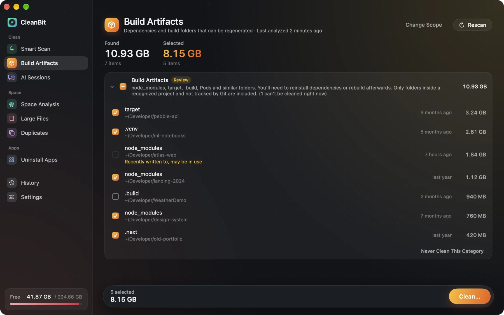

**Yes—you can safely delete `node_modules` folders in inactive projects on macOS.** Every package inside `node_modules` can be reinstalled later with `npm install`, `yarn`, `pnpm install`, or `bun install` as long as your `package.json` and lockfile are intact.

If you build side projects or use AI coding tools like Claude Code, Cursor, or Codex, `node_modules` folders pile up quickly across dozens of folders and `git worktree` checkouts you no longer open (see our dedicated guides on [finding and removing leftover Claude Code git worktrees](/guides/claude-code-worktrees-disk-space-mac/) and [Claude Code, Cursor, and Codex disk space on macOS](/guides/claude-code-cursor-codex-disk-space-mac/)). On one developer Mac we measured (macOS home folder, excluding `~/Library`), there were **304 `node_modules` folders occupying 66.3 GB** in total—alongside 8 `.venv` folders (5.1 GB) and 7 `.build` folders (2.9 GB). Every machine varies widely, so start by measuring your own.

## 1. Measure how much space `node_modules` takes on your Mac

Before deleting anything, run a read-only command to list the largest top-level `node_modules` directories inside your home folder. Using `-prune` is important because it stops `find` from descending into nested `node_modules` directories and double-counting them:

```bash
find ~ \( -path ~/Library -o -path ~/.Trash -o -name .git \) -prune -o \
  -type d -name node_modules -prune -exec du -sh {} + 2>/dev/null \
  | sort -h | tail -25
```

To count how many `node_modules` directories exist in your workspace folder (for example `~/Projects`):

```bash
find ~/Projects -name node_modules -type d -prune | wc -l
```

## 2. Check when each project was last touched

Deleting `node_modules` in a project you are actively running will break your dev server until you reinstall. Filter by projects whose `node_modules` hasn't been modified in more than 60 days:

```bash
find ~/Projects -name node_modules -type d -prune -mtime +60 -exec du -sh {} + 2>/dev/null | sort -h
```

> [!WARNING]
> Always inspect the printed list before running any delete command. Never run recursive deletion directly on `~` without excluding `~/Library` and verifying no repository accidentally committed `node_modules` to Git.

## 3. When you should NOT delete `node_modules` blindly

- **Active projects**: Any project currently running a dev server, watcher, or build process.
- **Git-tracked `node_modules`**: Rare, but some legacy repositories commit vendored dependencies into Git. Check with `git ls-files node_modules | head` first.
- **Projects using `pnpm`**: `pnpm` hard-links files from its shared store (`~/Library/pnpm`) into each project's `node_modules`. Deleting one project's `node_modules` may not reclaim the full size shown by `du` until you run `pnpm store prune`.
- **Offline travel**: If you need to work on a project without internet access, keep its `node_modules` until you're back online.

## 4. Delete old `node_modules` safely from Terminal

Instead of permanently destroying directories with `rm -rf`, a safer habit on macOS is moving selected folders to the Trash or using `npx npkill` interactively inside a specific projects directory:

```bash
# Option A: Inspect and delete interactively inside a single folder
cd ~/Projects
npx npkill

# Option B: Reclaim unreferenced packages from the pnpm store
pnpm store prune
```

If you prefer deleting a single specific folder once you have verified the path:

```bash
rm -rf ~/Projects/old-demo/node_modules
```

## 5. Inspect and clean visually with CleanBit

I'm the developer of **CleanBit**, a sandboxed Mac App Store disk space cleaner for macOS 15+. If you don't want to write `find` commands or worry about wiping something Git tracks:

- **Build Artifacts** scans `node_modules`, `target`, `.build`, `.venv`, and `Pods` across the folders you grant and shows **when each project was last modified**.
- Anything tracked by Git is automatically skipped, and recently modified folders are flagged as in use.
- Project build folders are categorized as **Review** (never pre-selected) and are always **moved to the Trash**, so you can put them back if you need to.
- CleanBit also shows your `pnpm` store as **Info Only** (never deleted directly) and reminds you to use `pnpm store prune`.

For other common macOS storage folders outside your project directories, see our guides on [whether `~/Library/Caches` is safe to delete](/guides/is-it-safe-to-delete-library-caches-mac/), [cleaning Xcode `DerivedData`](/guides/is-xcode-deriveddata-safe-to-delete/), and [reclaiming space from `iOS DeviceSupport` and Xcode Simulators](/guides/ios-devicesupport-and-simulators-disk-space-mac/).



## Frequently Asked Questions

### Is it safe to delete `node_modules` on a Mac?
Yes, as long as the project is not currently running and its `package.json` (and lockfile) is intact. You will simply need to run `npm install` (or your package manager's install command) the next time you work on that project.

### Why didn't my free disk space increase immediately after deleting `node_modules`?
Two common reasons: if you moved folders to the Trash, space isn't reclaimed until you empty the Trash; and if the project used `pnpm`, packages are hard-linked to the shared store—run `pnpm store prune` to free unreferenced packages. macOS may also hold purgeable space or APFS local snapshots temporarily.

### Does deleting `node_modules` affect global npm packages or Node.js itself?
No. Project-level `node_modules` folders only contain dependencies for that specific project. Your Node.js installation, global CLI tools, and source code remain untouched.
