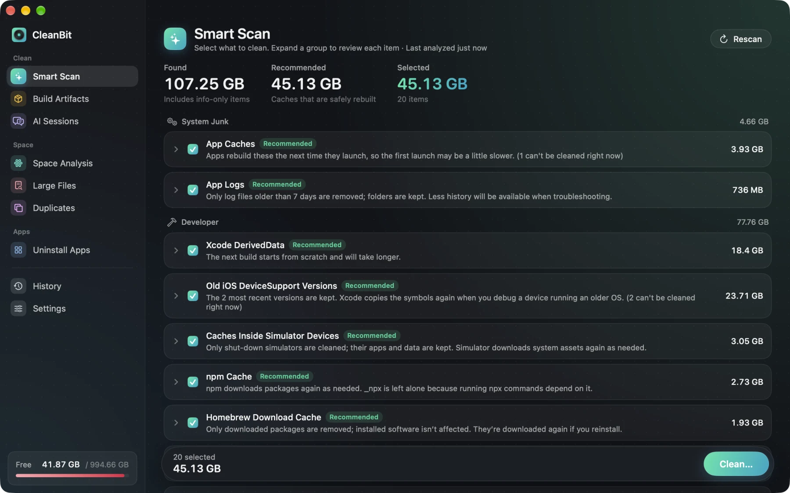

**Yes—Xcode's `DerivedData` folder is completely safe to delete.** Xcode automatically regenerates everything inside it the next time you open and build a project. The only trade-off is that your next build and index for each project will start from scratch and take longer.

On one developer Mac we measured, `~/Library/Developer/Xcode/DerivedData` occupied **15.3 GB** (and adjacent Xcode storage was even larger: **24.1 GB** in `iOS DeviceSupport` and **43.0 GB** in `CoreSimulator/Devices`). Your numbers will differ depending on how many projects and iOS SDKs you work with.

## What is inside `~/Library/Developer/Xcode/DerivedData`?

Whenever you open a project or workspace in Xcode, it creates a subfolder inside `DerivedData` containing:

- **Build intermediates and compiled binaries** (`Build/Intermediates.noindex`, `Build/Products`)
- **Code completion and navigation indexes** (`Index.noindex`)
- **Build and test logs** (`Logs`)
- **Resolved Swift Package checkouts** (`SourcePackages`) when using SwiftPM inside Xcode

None of your source code lives in `DerivedData`. It is purely generated build output and cache data.

## When should you quit Xcode before deleting it?

Always **quit Xcode first** before deleting `DerivedData`. Removing files while Xcode is actively indexing or compiling can cause failed builds or stale editor warnings until you restart Xcode.

Also keep in mind: if a project pulls Swift Packages from the internet, the next open after clearing `DerivedData` will re-fetch or re-resolve those packages, so avoid wiping it right before boarding a flight without Wi-Fi.

## How to check and delete `DerivedData` manually

### Check how much space Xcode folders occupy (read-only)

```bash
du -sh \
  ~/Library/Developer/Xcode/DerivedData \
  ~/Library/Developer/Xcode/iOS\ DeviceSupport \
  ~/Library/Developer/CoreSimulator/Devices \
  ~/Library/Developer/Xcode/Archives 2>/dev/null
```

### Option 1: Remove via Finder

1. Quit Xcode.
2. In Finder, press `Shift + Command + G`.
3. Paste `~/Library/Developer/Xcode/DerivedData` and press Return.
4. Select the project folders you no longer need (or everything inside `DerivedData`) and move them to the Trash, then empty the Trash.

### Option 2: Remove via Terminal

```bash
# Quit Xcode first, then clear the contents of DerivedData
rm -rf ~/Library/Developer/Xcode/DerivedData/*
```

### Option 3: Check other Xcode folders carefully

| Folder | Safe to delete? | What happens |
|---|---|---|
| `DerivedData` | Yes (rebuilt automatically) | Next build & index takes longer |
| `iOS DeviceSupport` (older versions) | Usually yes | Xcode re-copies symbols if you reconnect an older iOS device |
| `CoreSimulator/Caches` | Yes (when simulators are shut down) | Simulator regenerates caches as needed |
| `Xcode/Archives` | **Review carefully** | Contains `.xcarchive` builds & dSYMs used to symbolicate App Store crash logs—do not delete blindly |

> [!NOTE]
> `DerivedData` is only one piece of developer storage. Before deleting `Archives`, make sure you no longer need the dSYM files for shipped app versions. If you also use AI coding agents that spin up isolated worktrees or duplicate builds, see our guide on [where Claude Code, Cursor, and Codex store disk space on macOS](/guides/claude-code-cursor-codex-disk-space-mac/) and [cleaning old `node_modules` folders](/guides/how-to-find-and-delete-old-node-modules-on-mac/).

## How CleanBit handles Xcode storage

I'm the developer of **CleanBit**, a sandboxed Mac App Store disk space cleaner for macOS 15+. CleanBit separates Xcode folders by risk instead of lumping them together:

- **Recommended** (rebuilds automatically): `Xcode DerivedData`, old `iOS DeviceSupport` versions (keeping the 2 most recent), SwiftUI Preview Data, and caches inside shut-down Simulator devices. Caches of apps that are currently running are blocked automatically.
- **Review** (not pre-selected, always moved to Trash): `Xcode Archives`, so you don't accidentally wipe shipped build archives.
- Before confirming, CleanBit splits how much will be permanently deleted vs. moved to the Trash—and you can switch Recommended caches to Trash in Settings if you prefer.



## Frequently Asked Questions

### Will deleting `DerivedData` delete my source code or Git history?
No. Your source code and `.git` repository live in your project directory, not in `~/Library/Developer/Xcode/DerivedData`.

### How often should I clear Xcode `DerivedData`?
You don't need to clear it on a strict schedule. Clearing it once every few weeks—or whenever you finish a major project, upgrade Xcode, or see unexplained build glitches—is usually enough.

### Does deleting `DerivedData` break Swift Package Manager dependencies?
No, your package list is defined in `Package.swift` or your `.xcodeproj` and `Package.resolved`. Xcode will re-resolve and rebuild packages automatically the next time you open the project (an internet connection may be required if packages are not cached elsewhere).
